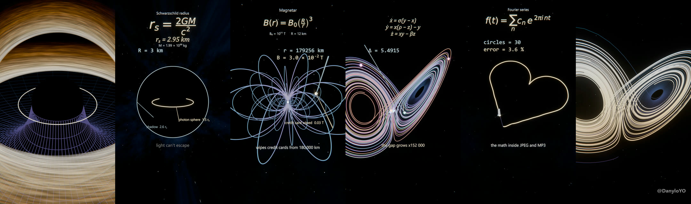
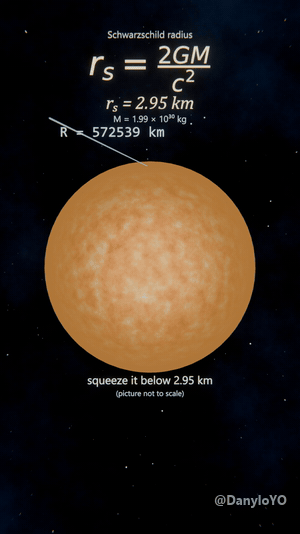
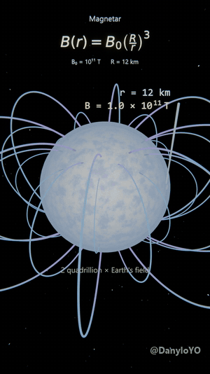
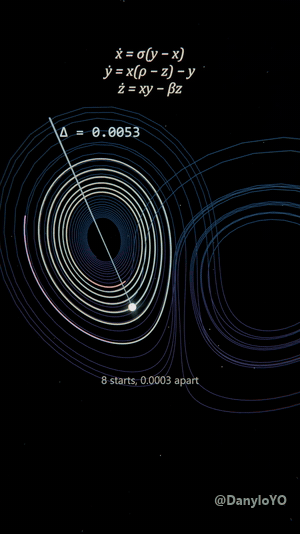
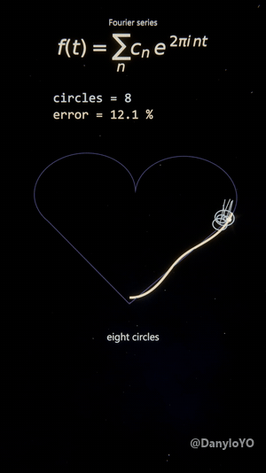
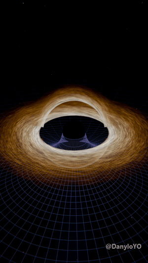
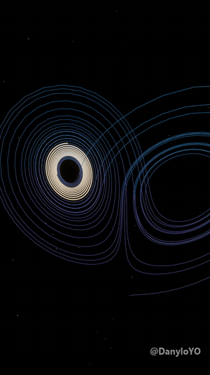

# Cosmic CGI Studio

**Scientifically exact 3D shorts about space and mathematics, generated entirely from code in Blender.**

Every scene is built by a Python script, every number on screen is computed from the real equations, and every artistic shortcut is labelled as one. The output is vertical 1080×1920 video for TikTok, Reels and Shorts.

> The source code of the studio is private. This repository is a showcase: finished work, the science behind it and how the pipeline works. Previews are reduced in size and watermarked. See [License](#license).

---

## Finished videos

<table>
<tr>
<td valign="top" width="260"></td>
<td valign="top"><h3>Black hole radius</h3><b>Idea:</b> squeeze any mass below rs = 2GM/c² and it becomes a black hole. For the Sun that is 2.95 km.  The Sun shrinks while a live counter runs from 695,700 km to 3 km. Light goes out, then the photon sphere (1.5 rs) and the shadow (2.6 rs) appear with dimension rings. Background stars are lensed by the hole.  <b>Exact:</b> rs from CODATA constants, photon sphere 3M, shadow bcrit = 3√3 M, weak-field lensing. <b>Labelled on screen:</b> the shrink is drawn on a log scale ("picture not to scale").  <a href="media/video/bh_radius_540x960.mp4">Watch (540p)</a></td>
</tr>
<tr>
<td valign="top" width="260"></td>
<td valign="top"><h3>Magnetar</h3><b>Idea:</b> a magnetar's field is 10¹¹ T at the surface and falls as 1/r³. It would still wipe a credit card from 180,000 km, halfway to the Moon.  A probe on the magnetic equator carries two counters, distance and field in scientific notation. The camera pulls out at true scale while ever larger dipole shells appear. Milestones: MRI scanner strength at 38,620 km, card erasure at 179,256 km.  <b>Exact:</b> dipole law B = B₀(R/r)³, field lines r = L sin²θ, every counter value, the zoom itself. <b>Assumptions on screen:</b> R = 12 km, B₀ = 10¹¹ T.  <a href="media/video/magnetar_540x960.mp4">Watch (540p)</a></td>
</tr>
<tr>
<td valign="top" width="260"></td>
<td valign="top"><h3>The butterfly effect</h3><b>Idea:</b> the same three equations, starts that differ by 0.0003, and a few seconds later the paths sit on opposite wings. That is why weather forecasts fail after about two weeks.  Eight heads start on the Lorenz attractor. The equations are on screen and a Δ counter shows the gap growing more than 150,000-fold, computed from the simulation frame by frame.  <b>Exact:</b> Lorenz system (σ = 10, ρ = 28, β = 8/3) integrated with RK4, separation per frame.  <a href="media/video/butterfly_540x960.mp4">Watch (540p)</a></td>
</tr>
<tr>
<td valign="top" width="260"></td>
<td valign="top"><h3>Fourier heart</h3><b>Idea:</b> any closed shape is a sum of circles spinning at whole-number speeds. More circles, less error. The same math sits inside JPEG and MP3.  Chains of 1, 3, 8 and 30 epicycles draw a heart. Counters show the number of circles and the maximum error: 56.3 %, 35.8 %, 12.1 %, 3.6 %.  <b>Exact:</b> discrete Fourier transform of the outline, ring radii and rotation rates, error values. <b>Design note:</b> the heart has corners on purpose. The classic smooth heart curve has only four harmonics, so "more circles" would stop improving it after eight.  <a href="media/video/fourier_heart_540x960.mp4">Watch (540p)</a></td>
</tr>
<tr>
<td valign="top" width="260"></td>
<td valign="top"><h3>Falling into a black hole</h3>A cinematic fall into a Schwarzschild black hole: the curved-space throat (Flamm paraboloid), an accretion disk with Keplerian rotation, and gold photon paths bending around the hole.  <b>Exact:</b> horizon 2M, photon sphere 3M, shadow 3√3 M, ISCO 6M, null geodesics integrated with RK4. <b>Approximation, labelled:</b> lensed disk arcs are ribbons; star lensing is first-order.  <a href="media/video/black_hole_540x960.mp4">Watch (540p)</a></td>
</tr>
<tr>
<td valign="top" width="260"></td>
<td valign="top"><h3>Lorenz storm</h3>Eight identical-looking starts trace the same path, then tear apart across the attractor. The first study of the chaos series, later developed into the explained butterfly video.  <b>Exact:</b> Lorenz ODE with RK4.  <a href="media/video/lorenz_storm_540x960.mp4">Watch (540p)</a></td>
</tr>
</table>

---

## How it is made

There is no hand-made 3D scene in this project. Each video is a script.

1. **Physics or math model first.** The model is written in plain Python with its own validation tests: capture of light below the critical impact parameter, the 4M/b deflection limit, energy conservation of the double pendulum, divergence-free fields, dipole field lines checked against numerically integrated streamlines, and more. A scene is built only after its tests pass.
2. **Procedural scene build.** A build script drives Blender 5.2 headless through a shared library of generators: geodesic bundles, field lines, epicycle chains, parametric surfaces, lensed star skies, an orbit camera rig.
3. **Explanation layer.** Equations are typeset from LaTeX and imported as vector curves. Live counters are Geometry Nodes text driven by per-frame data, so the number on screen is the number from the simulation. Leader lines connect objects in the scene to the labels that explain them.
4. **Preview and review.** Low-resolution frames are rendered and assembled into contact sheets, and every change of direction is checked on real images before the final render.
5. **Final render and automated QA.** Cycles on the GPU, AgX colour management, a compositor glow chain. A watcher follows the detached render, then the video is encoded and checked for resolution, duration, brightness per second and black stretches.
6. **Honesty report.** Every project ends with a report that separates what is exact, what is an assumption and what is artistic.

### In numbers

| | |
|---|---|
| Finished videos | 6 |
| Validation tests in the physics and math libraries | 60, all passing |
| Studio code | about 3,600 lines of Python and shell |
| Render time per 15-second video | 38 to 60 minutes on a laptop RTX 4060 |
| Format | 1080×1920, 24 fps, 15 s, H.264 |

### Tools

Blender 5.2 (Cycles, Geometry Nodes, headless Python API) · Python (RK4 integrators, DFT, field models, no external numeric dependencies) · matplotlib mathtext for equations · FFmpeg for encoding and QA · librosa for a beat detector that cuts shots to music · developed with Claude Code.

---

## Topics in progress

Wave interference and noise-cancelling headphones · a hundred double pendulums diverging · three-body orbits · gravitational waves on a ringing grid · minimal surfaces and Klein bottles.

---

## Source code

The code of the studio is not public. If you are interested in a collaboration, a commission or the project itself, open an issue in this repository or contact me through my GitHub profile.

## License

Copyright © 2026 DanyloYO. **All rights reserved.** The videos, previews, images and texts in this repository may not be copied, re-uploaded, modified or used in other works without written permission. See [LICENSE](LICENSE).
